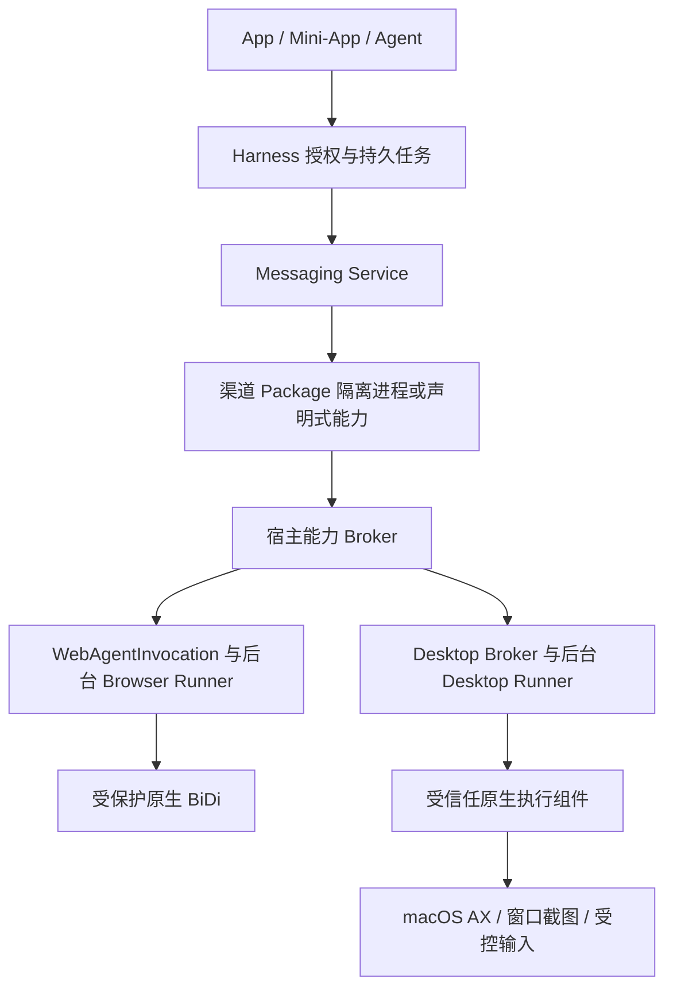

# AI2Apps Harness Computer Use 能力盘点与补齐方案

日期：2026-10-16。状态：源码盘点与设计提案，尚未实施。参考代码：`fa377dcb` 与当前工作区。

Computer-Use 是 Harness 的平台执行能力。浏览器继续使用现有 WebAgent/BiDi；原生桌面补齐受控 Desktop Broker 与执行器。微信等渠道 Package 提供平台识别和业务流程，通过宿主授权调用执行能力，不自行获得不受限的桌面控制权。Runtime 是部署与依赖单元，不决定能力归属。

## 1 盘点结论与证据范围

现有 Harness 已有工具发现、能力策略/租约、人工交互、持久运行和浏览器后台执行基础。原生桌面的观察、目标绑定、输入、跨实例协调与 Package 受限调用链仍需建设。

本次检查 Local 的 agents、services、capabilities、processes、browser、packages、platform_runtime，Desktop 的 Swift Sources、entitlements 与相关打包脚本，以及 Package/浏览器架构文档。没有扫描用户聊天、Cookie 或 TCC 数据库，没有操作微信，没有修改系统权限。未对完整 Firefox 上游、已安装 App 二进制或实际系统授权做全量审计；“未找到”仅指本次检查范围。

macOS 系统设置里的授权条目、程序签名 entitlement、可执行代码和对 Package 开放的契约是四件事。源码和 plist 不能证明某台机器当前已获授权，也不能推断 Package 子进程继承该授权。本方案不否定用户看到的授权条目。

| 能力 | 当前状态与证据 | 补齐点 |
| --- | --- | --- |
| 工具调用与 schema | `services/registry.py` ToolGateway 校验工具启用状态、provider、能力与输入；`agents/general.py` 按 allowed_tools 发现工具 | 注册 Desktop 工具，补目标级 scope，不另造 Agent 工具循环 |
| 权限与人工确认 | `capabilities/policy.py` 评估策略和 GrantLease；`agents/runtime.py` 创建 APPROVAL interaction | 在已有租约上增加原生目标/动作/Package scope，执行时再次验证 |
| Agent 生命周期 | `agents/runtime.py` 已有取消、恢复、预算和交互 | 原生执行器对接同一生命周期，取消不能误报为动作未发生 |
| 浏览器后台执行 | `browser/invocation.py` → BrowserTaskRepository → BackgroundBrowserRunner；固定 generation、owner/session/Profile | 原样复用；Package 的网页业务走已有受信任提交链 |
| 浏览器控制与观察 | `browser/background_bidi.py`、`shell_bidi_gateway.py` 连接受保护 BiDi；DOM、截图、输入由该链路执行 | 不把它扩展为原生桌面协议，不重复 BiDi method catalog |
| 浏览器动作恢复 | `browser/action_journal.py` 保存动作 claim/结果，未完成动作转 uncertain；runner 提交失败观察 | 提炼公共结果/幂等语义，原生记录独立存储，不直接复用浏览器 context 字段 |
| 输入锁 | `browser/background_runner.py` 的 input_locks 按 owner/Profile 存于进程内 | 不是全桌面、跨 Local 实例的协调器；补 OS 登录会话级独占机制 |
| 进程与 Broker 基础 | `processes/authority.py` 有短期签名 envelope；processes/service 提供进程工具 | 可复用模式，不能当作已有 Desktop Broker；需加入 Package/目标/请求哈希绑定和重放消费 |
| Package 隔离 | `packages/runtime.py` 拒绝第三方 in_process；supervisor 提供受限 managed process | 保持隔离，不因 AI2Apps 发布者签名而提权 |
| Package 调用身份 | 普通 Service `_http_json` 当前传 arguments 和 trace header | 不具备完整 Package→宿主桌面授权通道；新增不可伪造 invocation-bound 通道 |
| 原生 AX、截图、输入 | 在检查的 Swift/Local 源码中未找到 AXUIElement、CGEventPost、ScreenCaptureKit 等完整执行服务 | 新建受信任执行组件并实机验证 |
| “准备录屏” | Helper 与 apply-screen-recording-shell.py 调整自有 Shell 尺寸/位置；开发文档明确不启动录制 | 不能作为现成桌面截图服务证据 |
| 系统权限 | 已读 Desktop entitlement 文件；未核对实际 TCC 授权 | 先验证获授权进程与责任 App、撤销和升级行为，不从 plist 推断权限状态 |

架构依据：仓库根目录 `docs/ai2apps-browser-control-architecture.md`、`docs/ai2apps-package-runtime-isolation-macos-v1.md`、`docs/service-package-sandbox-development-guide.md`。当前 Managed Service 的 sandbox-exec 是过渡隔离；签名 XPC Runner 仍是文档中的待完成项，不能描述为已部署能力。

## 2 分层与部署决策

推荐首期：Desktop Broker 属于 Host；原生执行器为随 Desktop 构建、稳定签名、独立运行的组件。Package 的 Python/识别依赖继续在隔离环境运行，不导入 Helper/Host。原生执行器只接受校验后的操作，不能加载 Package 任意代码。具体采用独立 helper 还是 XPC 由原型验证确定，必须与现有隔离路线协调。

通用 Computer-Use Runtime Package 可承载版本化依赖、图像处理或隔离业务 worker，但普通可下载 Runtime 不自动取得 Host 身份和宽泛 TCC 权限。若将原生执行器也独立发布，必须先建立对应签名验证、进程认证、升级、授权稳定性与撤销契约；不能仅把 runtime.mode 设为 external 绕过 sandbox。

因此“用户独立安装微信 Package”可实现为自动解析依赖和检查宿主最低版本；不承诺第一次引入系统执行能力无需 Desktop 更新。后续微信规则升级通常不要求重建宿主。

## 3 原生能力契约

以下命名为拟新增契约，不是当前已有工具。Agent 经 ToolGateway 调用；Package 经受限 Broker 调用；两者落入相同授权和执行实现。

| 接口 | 语义与约束 |
| --- | --- |
| desktop.permissions.status / request | 查询实际可用权限；request 进入用户交互，不自行点击系统授权；拒绝时明确 unavailable |
| desktop.targets.list / bind | 按获准 bundle ID 与已验证进程身份定位，返回 opaque target_handle；不能仅按标题/前台选择 |
| desktop.windows.list / bind | 限定 target 内窗口；记录进程启动代次、窗口标识与授权版本 |
| desktop.observe | 读取目标 AX 树，限定深度/节点数；返回 snapshot_id、revision、稳定性、局部 element handles |
| desktop.capture | 默认目标窗口截图，返回授权资源引用、逻辑/像素尺寸、缩放及坐标变换；全屏为额外授权 |
| desktop.actions.perform | 结构化 AX press/setValue/focus、点击、滚动、键盘/输入；固定目标、request_id、snapshot 前置条件 |
| desktop.actions.get / reconcile | 获取持久结果；reconcile 只读核对，不隐式重放动作 |
| desktop.watch | 有界观察订阅，AX 通知可用性不足时降级轮询；不等价于完整业务消息 Hook |
| desktop.control.release | 释放执行租约；不关闭用户 App 或窗口 |

元素引用绑定 snapshot 与目标，过期返回 stale_target，不能在新窗口沿用旧坐标。检查目标应用签名/路径与进程代次，防 PID 重用；窗口标题仅作显示。多显示器、Retina、窗口移动、最小化、遮挡和锁屏需要独立测试。不能可靠限定截图范围时拒绝，不静默扩大全屏采集。

AX 读取和窗口截图返回 coverage/unsupported；原生 App 不暴露结构时可采用获授权截图识别，但标注来源和置信度。消息/群成员稳定 ID 不能由 Computer-Use 凭空生成，仍由渠道适配器报告身份质量。

## 4 Package 调用与权限传播

### 4.1 声明和授权

沿用 Package manifest 现有 permissions 列表声明能力与 reason，拟新增 computer.desktop.observe、capture、interact 等能力名。target bundle allowlist、窗口范围、动作类别和后台权限采用经版本化 schema 验证的结构化声明；不能直接向当前严格 schema 插入任意字段。先扩展 schema 和工具授权规则，再发布依赖它的 Package。

实际授权为用户/actor 权限、App 声明、渠道 Package 声明、当前 Run GrantLease、目标限制的交集。外部消息发送还需 messaging.messages.send 和具体 conversation 授权；拥有桌面交互能力不替代通讯资源授权。后台任务不能依赖关闭后失效的 iframe Channel 继续冒用身份。

### 4.2 从 App 到操作结果

1. Mini-App 通过现有私有 MessageChannel 调用 Messaging Service；宿主校验 live mount、AppInstance、provider digest 和目标资源。
2. Service 固定 Operation、Package digest/version、目标连接与内部 session；通过 Registry 调用隔离 worker。
3. Host 为该调用创建短期、不可扩权的 Broker 会话，绑定 installation、actor、App、Package、worker generation、run、invocation、target、能力、有效期。
4. Worker 使用专用 SDK 通过宿主管理 IPC 发送结构化动作；Broker 校验 peer 身份、会话、请求哈希、序号及当前授权，再进入 Desktop Runner。
5. Desktop Runner 取得目标/输入租约、记录动作、调用原生执行组件，持久化结果并发布经过授权筛选的事件。
6. Package 根据观察证据给出业务结果；Messaging Service 记录发送/群操作状态。底层 click 成功不代表消息发送成功。

首期推荐继承的专用双向 IPC channel 或认证的受限 Unix IPC，禁止通过普通 HTTP arguments 传 Host 凭据。会话授予必须与 Supervisor 实际启动的 worker 身份关联；loopback、PID、Package 自报 service_id 均不足以单独认证。IPC 若需 sandbox 新规则，必须限定到该实例专用通道，不开放任意 loopback/Mach。

现有 BrokerAuthority 可作为实现参考，但其 session/run/operation 字段不足以满足这里的绑定要求。重放防护需要宿主持久 request_id/hash 和 nonce/sequence 消费；仅签名与 TTL 不防有效期内重放。取消、Package 禁用、升级、权限撤销或 worker 重启撤销对应会话。

### 4.3 三种 Package 使用方式

- App UI Package：只调用业务接口，不能直接拿 native executor 凭据。
- 声明式 WebAgent Package：沿用已签名 Source、generation 和现有 WebAgentInvocation；不迁移到 Desktop 模拟浏览器。
- 原生渠道 Service Package：在 sandbox 内执行平台策略，经 invocation-bound SDK 请求受限原生能力。所有外部传输和推送仍在各自适配器声明范围内。

为适配器扩展受控 Broker 能力，不向所有 Service 自动开放。旧 Package 不声明能力则行为不变；不支持新协议的 Host 明确拒绝安装/激活所需版本。

## 5 执行可靠性与用户接管

复用 AgentRun、Interaction、TaskTree、EventStore 与现有前台 SSE 模式。新增 Desktop Task 的执行 backend 和独立 action journal；BrowserTaskRepository 仍只负责浏览器 admission，不塞入伪造 Profile/context ID。公共调度可统一展示父子任务，但保持两类资源的调度语义。

动作 journal 使用 request_id + canonical payload hash + invocation + target generation，记录 accepted、started、completed 或 outcome_unknown。重复请求返回同一结果；hash 不同拒绝。OS 动作执行后写回前崩溃只能报告未知，不宣称 exactly-once 副作用；恢复与取消均不得自动重放未知点击/输入。

新增按 OS 登录会话协调的输入仲裁器，覆盖 dev/app-dev/test 等并行实例，仅共享锁和最小 owner 元数据，不共享业务数据或授权。优先目标定向 AX；使用全局键鼠、焦点或剪贴板时取得短期独占租约，具有 heartbeat、fencing generation 和超时恢复。原生执行器在每次动作前检查 fencing，不能仅依赖 Local 的内存锁。

现有浏览器输入锁是 owner/Profile 范围。纯 BiDi DOM 读取/协议输入不必一律争夺全桌面；涉及真实焦点、系统上传对话框、剪贴板或全局输入的路径才接入公共仲裁器。跨 Profile 的业务隔离继续保留。

用户介入、焦点或窗口变化时中止待执行动作并进入 needs_user/stale_target；为动作间竞态保留 outcome_unknown，不能承诺绝无竞争。提供可见执行状态和紧急停止，保证释放按下的按键/鼠标按钮。剪贴板尽量不用，确需使用时保存/恢复须检查 change counter，不能覆盖用户期间新复制的内容；已有草稿不覆盖。

人工登录和系统授权使用已有 Interaction。机器锁屏、休眠、切换登录会话使不适用操作暂停；后台任务并不等于可在锁屏或离线状态完成 GUI 操作。权限检查与 AX/截图 availability 为每次操作的前置条件。

## 6 数据与安全边界

截图/AX 文本为不可信内容，不得改变目标授权或触发新权限。按既有 privacy 模型路由处理需要视觉模型的任务；不静默回退默认 Cloud 模型。截图资源绑定 actor、App、Run 和用途，短期保留并受控读取；日志仅记方法、目标摘要、耗时、状态和证据引用，避免持久化全部屏幕或聊天正文。

系统 TCC 权限通常比业务 scope 宽；Broker 的限制属于我们必须实现的边界，不是 OS 自动按微信群授权。原生执行器拒绝任意脚本、模块导入、任意 PID 和路径参数；只接受 Host 验证的结构化请求。安全输入控件不返回密码；系统授权界面由用户操作。保持现有 Secrets/跨安装隔离，Package 无 Host 数据库和凭据读取权限。

## 7 分阶段补齐与验收

| 阶段 | 工作与交付 | 验收门槛 |
| --- | --- | --- |
| C0 实机能力与授权核验 | 验证固定 App/Helper/Shell 的签名身份、实际 TCC 归属、AX/截图可达性；用自有测试窗口验证 | 记录系统/组件版本、权限前后表现；不以 plist 或终端脚本成功替代 packaged-app 验证；确认需要复用或新增哪个组件 |
| C1 原生只读执行 | Desktop Broker、目标/窗口绑定、AX observe、窗口截图、权限状态和受控资源 | 测试目标不越界；跨 actor/实例拒绝；多显示器、缩放、权限撤销、窗口重建、锁屏覆盖 |
| C2 Package 调用边界 | 版本化 capability/manifest、Supervisor 专用 IPC、调用租约、SDK 和测试 Package | 真正 managed-process sandbox 下运行；伪造身份、重放、跨包、升级旧 token、取消后操作全部拒绝；不开放 broad Mach/网络 |
| C3 受控写入与 Harness 集成 | actions、全桌面仲裁、journal、取消/接管、任务/SSE 集成 | 在自有测试 App 验证焦点变化、草稿保护、剪贴板、超时和崩溃；未知写入不重放；两实例争用不并发注入 |
| C4 微信 Package 验证 | 依赖宿主接口完成指定会话定位、读取和文字发送核对 | 明确授权测试目标；同名和多窗口不误选；稳定身份不足则限制无人值守；实际业务回执，不以按回车成功验收 |
| C5 观察与通讯 Hook | 有界 AX watcher/轮询、checkpoint、消息归一化、Hook dispatcher | 证明事件范围、延迟和缺口；重复文本、权限撤销、断线补录、用户操作不触发回环；不承诺全量实时消息 |
| C6 发布与通用化 | 第二个原生 App 验证、原生组件打包/签名/升级、兼容矩阵与回滚 | 独立 Package 升级正常，OS 授权变化有恢复流程；正式发布走既有 Desktop/Package runbook |

先完成 C0 再定原生执行器部署形态；C1–C3 是基础设施门槛，C4 才验证微信业务。通用 Runtime 提取以两个实际消费者为依据，首期不建设任意桌面脚本执行平台。

## 8 代码落点与项目边界

拟新增 `computer_use/` 保存契约、授权目标、动作记录、Desktop 调度和资源引用；在 `platform_runtime.py` 注册生命周期，借用现有 TaskTree/事件和 ToolGateway。原生 Swift 组件放 Desktop Sources 的独立 target（名称在 C0 固定），不把 Package 代码载入现有 Helper。Package SDK 与 Supervisor IPC 变更位于 `packages/`；浏览器只在需要公共输入仲裁处做小范围适配。

本轮只新增/更新设计文档，不改变已发布行为，不启动安装或系统权限操作。实施开始即更新根目录 `docs/ai2apps-desktop-next-release.md`，无需用户提醒。Swift/Runtime/依赖变更通过标准固定 Dev/App-Dev builder；Python 变更经空闲检查后标准 Helper 重启；按源码合同验证元数据、运行模块和实际资产来源。

本方案不要求 Cloud 修改。未来若需要 Cloud 分发新的 manifest 字段或调度能力，单独输出 Cloud 需求并交接，不在本仓库实现 Cloud。与统一通讯方案的关系见 [统一通讯服务设计](unified-messaging-service-design.md)。
