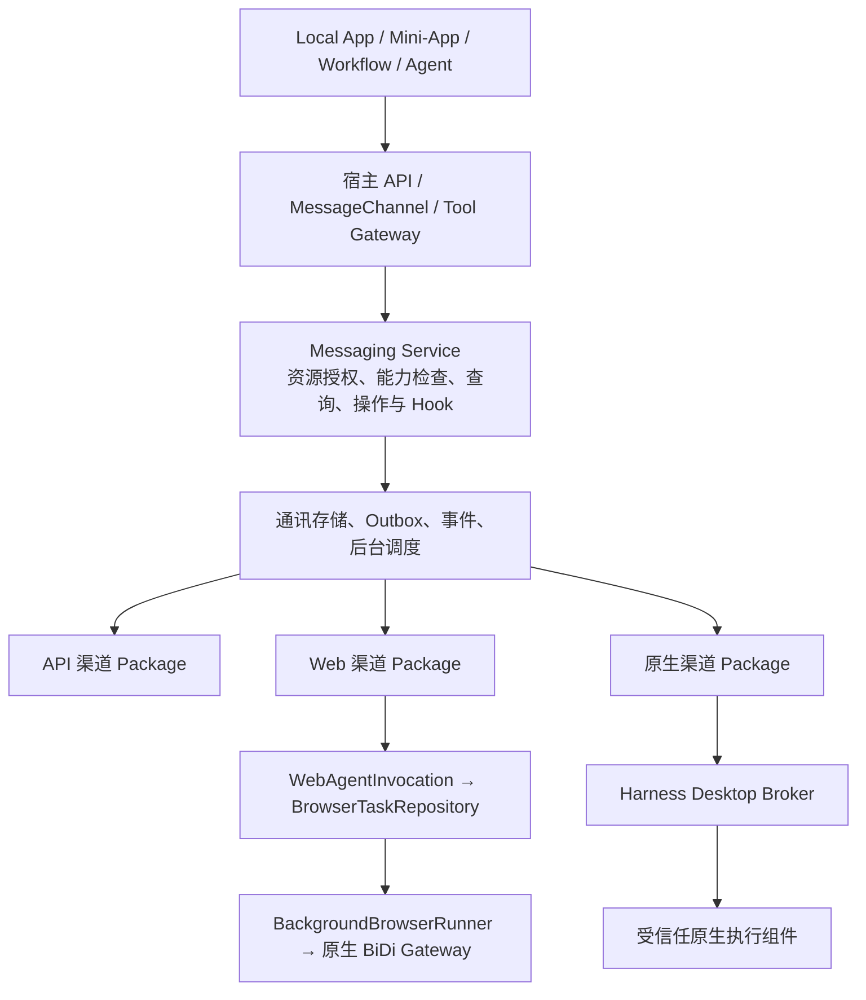

# AI2Apps 统一通讯服务层设计与实施计划

日期：2026-10-16。状态：设计提案，尚未实施。代码参考基线：`fa377dcb` 及当前工作区。

统一通讯服务 Messaging Service 为 AI2Apps App 提供联系人、外部聊天会话、消息收发、消息 Hook、群管理与通知投递能力。接入顺序为官方 API、现有 WebAgent、专用接入。渠道差异由独立安装的渠道 Package 和能力描述承担，App 使用同一套业务契约。Computer-Use 属于 Harness 平台基础设施，渠道 Package 复用其受限执行能力。

本文设计面向 Local 服务与 Desktop/Mini-App 接入；不承诺某个平台、账号类型已具备全部能力。WeChat、WhatsApp、Meta Messenger 是目标渠道；每个适配器上线前必须验证对应账号、接口权限和客户端版本。仓库现有 `messager/` 是 AI2Apps 自有点对点模块，与 Meta Messenger 分开命名。

## 1 现有架构与复用边界

| 现有基础 | 当前事实 | 本方案的接入方式 |
| --- | --- | --- |
| `services/models.py`、Service Registry 与 Tool Gateway | 工具已有 schema、effects、required_capabilities、retry_policy；ToolCallContext 携带 actor、installation、session 与 trace | 注册统一通讯工具，复用执行上下文与工具发现，不给各 App 暴露第三方原始工具 |
| `api/services.py` | 当前路由整体受 `app.system.manage` 保护；普通工具调用还要求授权的内部 session | 新建细粒度通讯 API；不能要求普通通知 App 获得系统管理权，也不能直接放宽整个 Service 管理路由 |
| `apps/access.py` | 角色到 App 入口权限映射，不是账号/群聊级资源授权 | 保留入口校验，增加通讯资源授权；角色通配权不替代对第三方账号的连接授权 |
| `browser/invocation.py` | WebAgentInvocation.submit 提交固定能力 generation，经 BrowserTaskRepository 入队 | Web 适配器作为可信 Local 调用方，复用唯一后台执行器 |
| `events/store.py`、`events/stream.py` | 事务事件、全局游标、提交通知和 SSE 重放 | 复用事件基础，另加通讯资源投影和逐订阅确认；不能将全局事件不经筛选直接给 App |
| Web-Agent Mini-App contract | 私有 MessageChannel，校验 live mount/provider digest，后台任务，SSE 状态 | 扩展通讯宿主 broker 与 SDK；不把完整浏览器权限给通讯 App |
| `remote/notification_host.py`、`api/notifications.py` | 已有自定义通知权限、登记路由与目标解析 | 保留现有站内通知通道；新增外部通讯投递目标，复用业务关联而不混用凭据或回执 |
| `messager/peer_service.py` | 自有 Cloud 授权、Local-first peer 通讯 | 后续可单独适配 `ai2apps_peer`，不重写其传输与授权协议 |

架构约束来源：仓库根目录 `docs/ai2apps-browser-control-architecture.md`、`docs/ai2apps-web-agent-mini-app-package-contract-v1.md`；补充实现说明见本目录 `webagent-background-migration.md` 和 `model-routing-profiles.md`。

## 2 服务结构



服务提供通讯业务接口，不创建第二套浏览器控制协议。Web 适配器实现站点任务和结果归一化；DOM、截图、输入等操作仍使用原生 BiDi 和共享 SDK。严禁新增 JSWindowActor 交互消息、语义浏览器 REST 封装或私有浏览器执行循环。

按能力选择执行后端。例如一个连接可以用 API 发消息、用 WebAgent 读取允许访问的会话。只有验证属于同一平台账号、同一目标会话且用户授权了对应方式，才能组合。业务账号 API 与个人 Web 账号不得因为显示名相同而拼接。

每个操作入队时固定 adapter/version、backend、账号身份、能力 generation 和目标。只读操作可按预先配置的规则降级；权限拒绝、登录过期、写入结果未知不能静默换渠道重做。

### 渠道 Package 与 Harness 的职责

每个通讯平台的适配器作为可独立安装、升级、禁用和卸载的 Package。一个平台可声明 API、WebAgent 和原生后端的组合，但账号和目标映射必须经验证。Messaging Service 持有业务权限、消息投影、Outbox 和 Hook；Package 持有平台流程、能力探测和结果归一化；Harness 持有任务执行、人工接管、浏览器及原生 Computer-Use 能力。

Package 注册契约拟包含 adapter protocol version、provider、supported account kinds、操作 schema、backend、资源授权需求、兼容宿主/Runtime 版本、结果 coverage 和健康探测。通过扩展现有严格 manifest schema 实现，不向旧 manifest 随意添加字段。Registry 根据签名和已安装 digest 注册，不能导入 Package 代码到 Host。新能力使用不同 provider 身份，业务 App 只看宿主统一接口。

独立安装可自动解析 Runtime 依赖；不要求每个渠道复制 Python/原生库。普通 Runtime Package 不继承宿主 TCC 权限，也不通过 external 模式规避 sandbox。原生系统权限由受信任组件和 Desktop Broker 管理；若宿主尚无该基础设施，首次支持需要 Desktop 升级。MCP 可作为适配器内部桥接选项，不是渠道 Package 必需协议。

Package 禁用停止新操作并撤销 Broker 租约；正在执行的写入先记录结果或未知状态再停止。升级固定 digest 并 drain 活跃操作，未知结果不能迁移为自动重试。卸载停止 Hook，用户选择本地数据保留；回滚只恢复代码兼容版本，不重放已执行操作。

原生基础设施盘点和 C0–C6 补齐计划见 [Harness Computer Use 能力盘点与补齐方案](harness-computer-use-gap-plan.md)。现有 WebAgent 的输入锁仅限 owner/Profile 与当前进程，不代表已实现跨实例全桌面输入协调。

## 3 对象与身份

所有对象均受 `installation + actor + connection` 边界约束，服务端从认证上下文派生 owner、AppInstance 和 mount，客户端不能自行声明身份。

| 对象 | 主要字段与含义 |
| --- | --- |
| Connection | id、provider、account_kind、verified_account_id、display_name、state、credential_ref 或 profile_binding、capability_revision |
| Contact | id、connection_id、provider_contact_id（可空）、display_name、kind、identity_quality、observed_at；可见资料按授权返回 |
| Conversation | id、connection_id、kind（direct/group/channel/bot/self）、title、participants_summary、unread_count（可空）、last_message_at、identity_quality |
| Member | conversation_id、contact_id、role、joined_at（可空）、observed_at；角色不明返回 unknown |
| Message | id、conversation_id、provider_message_id（可空）、sender、direction、content_parts、reply_to、sent_at（可空）、observed_at、revision、provenance |
| Attachment | id、media_type、name、size、availability、受控下载引用；不向 App 暴露本地任意路径或带令牌 URL |
| Operation | id、request_id、kind、目标、固定执行计划、state、outcome、证据引用、task_id、error、timestamps |
| Subscription | id、owner_app、连接/会话范围、事件筛选、授权版本、起始游标、投递目的地、state |
| HookDelivery | subscription_id、event_id、attempt、lease、ack、next_retry_at；唯一约束防止同一事件重复创建工作 |

外部聊天使用 `conversation_id`。现有 `ToolCallContext.session_id` 和 WebAgent 的 `session_id` 继续表示 AI2Apps 内部 session，绝不能填入外部群 ID。后台 Hook 必须使用持久且已授权的内部自动化 session；创建与绑定经宿主授权流程完成，不能假造 session 绕过 authorize_session。

联系人显示名不作主键，不跨渠道自动合并身份。缺少平台稳定 ID 时建立本地观察标识，并记录 `identity_quality=observed`；歧义返回候选供选择。无法稳定复认目标的适配器不能开放无人值守发送或群成员变更。

消息内容采用 typed parts：text、image、audio、video、file、location、system、unsupported。未知内容保留类型和可见摘要，不伪造全文。提及使用结构化 contact_id 映射，禁止把普通 `@名字` 当作已经成功通知对方。

## 4 能力发现与降级

`capabilities.get(connection_id, conversation_id?)` 返回逐操作能力，并同时考虑后端支持、平台账号权限、当前用户授权、目标群角色和连接健康状态。

```json
{
  "operation": "messages.list",
  "supported": true,
  "availability": "ready",
  "backend": "webagent",
  "coverage": "visible_window",
  "limitations": ["no_stable_provider_message_id"],
  "constraints": {"max_page_size": 50},
  "revision": 3
}
```

区分 unsupported、ready、needs_auth、needs_permission、temporarily_unavailable、unknown。读取范围标注 complete、partial、visible_window 或 unknown，绝不把当前 UI 可见列表当作全部通讯录或完整群历史。能力约束还可包含附件类型/大小、发送速率、时间窗口、模板要求和账号类型限制；这些由适配器实测/接口声明提供，前端不硬编码平台规则。

能力发现只是提示。执行时重新检查资源权限和角色，防止查询后权限改变。未知能力默认不可执行有副作用操作。

## 5 App 接口目录

以下为拟新增的 `AI2AppsMessaging` SDK / Python Service 方法；HTTP 使用宿主现有认证体系，建议命名空间 `/api/messaging/v1`，最终前缀按 router 挂载约定确定。Mini-App 通过同名宿主 MessageChannel 方法调用。所有入口委托同一个 Service，禁止各自实现业务与权限。

| 分组 | 方法 | 输入与语义 |
| --- | --- | --- |
| 连接 | connections.list / get | 只返回调用 App 获授权连接的元数据 |
| 连接管理 | connections.connect / reauthorize / disconnect | 管理授权单独校验；OAuth、扫码、OS 授权交由用户完成；不从 App 参数接收明文秘密 |
| 能力 | capabilities.get | connection_id、可选 conversation_id |
| 通讯录 | contacts.list / search / get | connection_id、query、cursor、limit；search 范围可受限，不等于全量枚举 |
| 会话 | conversations.list / get | 类型、更新范围、游标；包含可空未读数与数据覆盖范围 |
| 会话定位 | conversations.resolve | contact_id 或已观察平台目标，返回唯一会话或歧义；不会隐式发送消息 |
| 会话建立 | conversations.createDirect | 显式有副作用能力；仅平台支持时开放 |
| 会话操作 | conversations.markRead / archive / mute | 独立能力，读取内容默认不额外调用这些方法 |
| 内容 | messages.list / get / search | conversation_id、before/after、时间范围；search 返回搜索范围与完整性 |
| 同步 | sync.request / get | 请求刷新联系人、会话或消息，返回 Operation；页面不负责推进同步 |
| 发送 | messages.send | conversation_id、typed content、reply_to、request_id；返回持久 Operation |
| 消息管理 | messages.edit / delete / react | message_id、修改内容、expected_revision；撤回与仅本地删除明确区分 |
| 附件 | attachments.prepare / get / download | 受控上传/下载与配额；prepare 绑定 actor、App、连接及用途 |
| 群读取 | groups.get / members.list | conversation_id；公告、角色、成员范围按实际能力返回 |
| 群管理 | groups.create / update / leave | 名称、描述、公告、显式退出等结构化参数；不隐含解散群 |
| 成员管理 | members.invite / remove / setRole | 稳定成员标识、目标角色；每次执行重验自身管理权限 |
| 邀请链接 | groups.inviteLinks.create / revoke | 单独敏感权限，链接按秘密处理 |
| 操作 | operations.get / list / cancel / reconcile | 查询、尽力取消、只读核对；取消不代表撤回已发消息 |
| Hook | hooks.create / list / get / update / pause / delete | 事件类型、资源范围、持久消费者；更新使用 expected_revision |
| Hook 投递 | hooks.deliveries / ack / retry | 已授权消费者确认；retry 重试消费而非重做平台发送 |
| 前台事件 | events.watch | 授权过滤的 SSE/MessageChannel 更新，支持恢复游标 |
| 通知便捷层 | notifications.send / get | 已授权目标别名、内容、业务 request_id；归一化成 messages.send |

群消息复用 `messages.*`，群是 `Conversation.kind=group`，不创建平行群消息协议。邀请、移除、角色修改分别授权；不能以笼统 group.manage 自动获得全部权限。

### 查询与错误契约

列表统一返回 `{items, next_cursor, observed_at, coverage, gaps, sync_state}`。游标不透明且绑定连接、筛选条件与排序；失效返回 cursor_expired，再从授权快照恢复。首版默认本地缓存查询，`freshness=refresh` 返回同步 Operation，完成后重新读快照。缓存未命中不等于平台不存在。

稳定错误包括 permission_denied、unsupported_capability、auth_required、identity_ambiguous、account_mismatch、rate_limited、cursor_expired、history_unavailable、content_unsupported、idempotency_conflict、operation_outcome_unknown、adapter_drift。错误返回 retryable、retry_after、operation_id、需要的用户动作；不返回 Cookie、token 或原始网页秘密。

Web UI 读取可能触发平台的已读状态，即使没有调用 markRead；能力报告 `read_side_effects`，首次授予历史读取时说明。要求“读取但不标记已读”的 App 只能选支持该语义的连接。

### 调用示例

```javascript
// 拟新增接口，现有 SDK 尚未实现。connectionId 来自用户授权选择。
const page = await AI2AppsMessaging.conversations.list({connectionId, limit: 30});
const history = await AI2AppsMessaging.messages.list({
  connectionId, conversationId: selected.id, limit: 30
});
const op = await AI2AppsMessaging.messages.send({
  connectionId, conversationId: selected.id,
  content: [{type: 'text', text: '导出任务已完成。'}],
  requestId: 'export:job_456:completed'
});
// op 表示已接收操作；从 onOperation 或 operations.get 获取真实发送结果。
```

## 6 消息 Hook 与后台生命周期

Hook 是持久事件订阅与后台任务触发，不是注入第三方客户端的钩子，也不允许 App 提交任意 Python/JavaScript 回调。首版目的地仅支持登记的 Local handler 或已授权 Workflow/Agent capability；外部任意 Webhook 不在首版范围。

事件建议包括 message.received、message.updated、message.deleted、message.delivery_changed、conversation.updated、group.member_changed、connection.state_changed、sync.gap_detected 和 operation.updated。仅在确实观察到时发出，不从列表缺项推断删除或退群。

事件信封包含 schema_version、event_id、connection_id、conversation_id、message_id、occurred_at、observed_at、origin、causation_id、trace_id、coverage；actor/owner 信息供服务端过滤，不从订阅参数信任。SSE 默认只携带最小状态和对象引用；正文需要 messages.read 权限按需获取。

处理链路：

1. API 推送、增量 API 或 Web 同步观察消息；先校验来源与连接身份。
2. 在一个数据库事务中更新消息投影、去重记录、同步 checkpoint 与 EventStore 事件。
3. 持久 dispatcher 按已授权订阅产生 HookDelivery；提交之后才唤醒消费者。
4. 消费者以 `(subscription_id, event_id)` 幂等处理，成功后 ack；崩溃使用 lease 超时与退避恢复。
5. 超过重试上限进入 dead_letter，用户可检查和重试；消费者落后超过保留窗口返回 gap 并重新同步。

保证服务内事件至少一次投递；不保证端到端 exactly-once。平台稳定 message ID 优先去重；没有 ID 的 UI 观察只能使用会话、发送方、内容、邻接位置等弱指纹并标注置信度。同一人连续发送相同文本不能只凭内容去重。弱身份适配器不能宣称可靠全量监听。

首次订阅默认为 from_now，历史补录带 `origin=backfill`，默认不触发自动回复。默认排除本服务发送回声；保留来源与因果链，设置响应预算/冷却，避免跨渠道机器人回环。消息正文作为不可信数据，不能自行授权改权限、扩大群范围或执行指令。

前台订阅与后台 Hook 分离：关闭 App 页面只撤销 UI 监听，已授权的持久 Hook 继续由 Local 执行；卸载 App、撤销资源授权或断开连接停止后台 Hook。每次执行和投递都复验权限。Local 退出/机器休眠期间不承诺在线接收，恢复后尽力补录并报告缺口。

## 7 可靠发送与群管理

写操作先以事务写入 Operation/Outbox 和事件，再返回 accepted。幂等唯一键为 `(actor, app_instance, connection, request_id)`，规范化请求哈希不同则冲突；重复提交同一请求返回原 Operation。持久请求键保留窗口必须至少覆盖自动重试和恢复周期，并在协议中公布，过期不承诺去重。

执行状态：queued → running → succeeded / failed / outcome_unknown；等待用户授权为 needs_user，取消分 cancel_requested 与 cancelled。投递状态单独记录 submitted、sent、delivered、read、unknown，仅依据渠道证据升级；succeeded 不等于 delivered。

提交前确认目标与平台账号；API 优先使用平台幂等键。Web 写入使用固定能力计划、现有动作日志和提交后的结果核对。遇到超时、崩溃或断连，先查平台回执/目标历史，不重放不确定提交；无法核实时维持 outcome_unknown，交给用户决定是否创建新操作。多个附件拆分时返回逐部分结果，禁止把部分成功当成全失败后整批重发。

群成员与公告修改可复验当前状态；无法证明成功则同样报告未知。退出群、移除成员等动作执行前使用最新授权与目标快照。Outbox 不持有数据库事务等待网络；租约防止两个 worker 同时发送。同一 UI 客户端串行，API 并发遵守连接/会话限流及平台约束。

## 8 WebAgent 与专用适配器

Web 适配器调用 `WebAgentInvocation.submit`，显式提供 owner、已授权内部 session_id、caller_app_id、profile、agent_id、capability、generation_id、稳定 key 和业务参数。operation 可绑定统一 TaskTree 的父任务；BrowserTaskRepository 保持唯一 admission authority，BackgroundBrowserRunner 保持唯一浏览器执行器。

固定 generation 通过共享编译器和策略检查后激活。平台页面变化时暂停该能力并返回 adapter_drift；新规则经实际页面验证后替换。发送目标和正文固定为参数，不能由网页文本改变。涉及模型的通讯任务默认采用现有 privacy 模型配置，不隐式回退 normal；显式授权的模型路由仍由用户配置决定。

Profile 必须属于 actor，native context/userContext 显式绑定。使用用户授权的现有 Profile，不复制 Cookie，不创建第二临时 Profile 冒充原登录，不按前台焦点选窗口。API token 存 SecretBackend，Web 仅存 Profile 引用，不从浏览器抽取 token 复用成“API”。

首版 Web Hook 使用有界、可配置的后台同步 Task，每轮结束按共享生命周期关闭自有页面。用户借用页面不自动关闭。持续保留需明确 retain_pages_reason 和拥有任务；轮询有冷却、预算、退避和公平调度，不能用永久 Task 占住 Profile 名额。是否支持更长生命周期事件观察，应作为共享 WebAgent 能力演进单独验收。

沿用 action journal：不确定动作产生 action_outcome_unknown 且 automatic_replay_allowed=false；普通传输故障与 needs_user 分开。登录/验证码交给现有人工协助入口，恢复同一 run 时遵守最新队列 admission 规则。

原生渠道 Package 只在 API/Web 无法满足时启用。微信 Package 可借鉴 WeChat-MCP 的实现，不要求运行其 MCP Server；直接实现统一通讯适配协议。它经 invocation-bound Desktop Broker 请求目标受限的 AX、截图和输入，不能自行控制整个桌面。Package 的版本、依赖、日志隐私、目标确认、中文/群聊兼容和业务结果证据需要验收；原生权限、输入仲裁、动作恢复由 Harness 负责。安装 Package 本身不等于获得可靠消息 Hook 或群管理能力。

## 9 权限与数据

拟新增细粒度权限：messaging.connections.read/manage、contacts.read、conversations.read、messages.read/send/manage、attachments.read/write、groups.read/create/update、members.invite/remove/roles、hooks.manage。每项再受 connection、conversation、目标范围、内容类型与后台执行许可限制。

最终权限为“已认证用户身份 ∩ App 声明 ∩ 用户资源授权 ∩ 平台实际能力”。Mini-App 不能自行传 actor/App/provider digest；宿主依据 live mount 生成上下文。后台执行依赖持久授权，不依赖已关闭 iframe 的 channel；mount 失效撤销交互会话，App 授权撤销则终止后续后台执行。

数据库建议新增 messaging_connections、identity_mappings、contacts、conversations、members、messages、attachments、operations、outbox、sync_checkpoints、grants、subscriptions、deliveries；事件复用 EventStore。每次资源读取、operation/task 查询与事件投递均做 owner/App/资源范围校验，不能只凭全局 sequence 或对象 ID 访问。

正文与附件按连接配置最短必要保留时间和容量，默认不做无限历史备份。事件/工具调用日志默认记引用与结果，不直接存聊天全文；应检查现有 Tool invocation arguments/output 持久化，新增脱敏或引用型参数机制后再开放消息工具。附件导出需重新鉴权，删除缓存不等于删除平台消息，disconnect 与删除本地数据分开操作。dev/app-dev/test 数据完全隔离。

## 10 通知与 Cloud 边界

通知目标登记为明确授权的 `connection + conversation` 别名；业务 App 可以只有向该目标发送的权限，无需读通讯录或群历史。notifications.send 使用业务稳定请求键，可附 trace/task 引用，模板渲染后进入同一 Outbox。每个渠道产生独立回执，平台不支持的内部 App 链接不能原样当作可访问公网链接。

现有站内通知继续走 NotificationHost。外部消息失败不会被站内通知成功掩盖；多渠道投递逐目标报告，不隐式复制到用户未选择的渠道。

首期完全 Local。若官方 API 的入站 Webhook 需要公网回调，可使用用户已配置且经过授权的受保护入口；没有可用入口时将该能力标记为待配置，不能自动发布 Local 服务到公网。未来需要 AI2Apps Cloud 中转时，另写 Cloud 需求文档，定义签名验证、challenge、租户映射、去重、加密队列、离线保留、拉取/ack、撤销与投递 SLO，由 Cloud 项目实施部署。本仓库不直接修改 Cloud。

## 11 分阶段实施与验收

阶段按验收门槛推进，不以某个平台营销能力作为完成依据。平台能力核验表应记录渠道、账号类型、API/Web/专用方式、可用操作、稳定 ID、消息获取方式、平台限制、验证版本/日期。

| 阶段 | 交付与涉及模块 | 进入下一阶段的门槛 |
| --- | --- | --- |
| P0 契约与渠道核验 | JSON Schema、渠道 Package 注册/依赖/升级契约、错误/状态模型、权限矩阵、能力表；确定 API 与 Web 试点，并对接 Computer-Use C0 盘点 | 对真实账号核验读写边界；冻结 v1 核心契约与身份规则；无生产写操作 |
| P1 Local 核心 | 新 messaging/ 模块，Runtime 生命周期、数据迁移、API/宿主 SDK、测试适配器、Outbox、资源授权和操作查询 | 重复请求/不同 payload 冲突、崩溃恢复、跨 actor/App/连接拒绝、未知结果不重发全部通过；不依赖系统管理权使用通讯接口 |
| P2 官方 API 通知闭环 | 一个官方 API 适配器，凭据托管、capability probe、文本/支持的附件发送、回执与限流；接一个真实任务通知 App | 用户指定测试目标端到端收到消息；App 关闭后仍执行；重复通知不重复提交；区分提交/送达状态 |
| P3 Web 通讯读取与发送 | 一个 WebClient 适配器、固定 generation、联系人/会话/内容覆盖标记、发送核验与人工登录恢复 | 同一个 App 只切换 connection 即完成相同契约；实际 BiDi/统一后台队列、Profile 隔离、页面清理、UI 漂移失败均通过 |
| P4 消息 Hook | 增量同步、EventStore 投影、持久订阅、delivery/ack、Workflow 触发、退避/死信/回环控制 | 重启/断线/重复事件/游标过期/权限撤销/关闭页面测试通过；记录真实捕获延迟与漏读范围，UI 轮询不宣称实时全量 |
| P5 群管理 | 群信息、成员、邀请、移除、角色和公告等逐项能力；支持的适配器先开放 | 在专用测试群验证角色变化、重名成员、部分成功与未知状态；不支持的平台返回明确错误；普通通知权限不能管理群 |
| P6 微信 Package 接入 | 依赖 Computer-Use C1–C3，借鉴候选项目的平台策略；经 Harness Desktop Broker 执行，渠道逻辑独立安装 | 达成 C4 实测：sandbox/IPC 授权、中文、多窗口、同名目标、权限撤销、发送核验和恢复通过；Hook 依赖 C5；弱身份限制无人值守 |
| P7 产品化 | 通讯连接管理 UI、App 资源授权、健康/操作/Hook 查看、版本迁移、容量和保留策略、渠道回归 | 至少 API 与 Web 两类真实渠道共用 SDK；兼容旧 App；失败隔离、升级/撤销/数据删除验收；按正式发布流程发布 |

P0 可以并列研究微信候选，但其特殊机制不反向决定核心接口。P2 的官方 API 通道允许只做通知；完整通讯录或个人聊天若不在其授权范围，应等 P3 适配，不能扩大声明。

### 必测场景

- 两个同名联系人、多个同名群、账号切换、Profile 不匹配、同一账号多连接，均不能误发。
- 两条相同文字的真实消息不丢失；重复 webhook 不重复触发；消息编辑与删除产生正确 revision。
- 写操作提交前崩溃、提交后回执前崩溃、多个 worker 抢占、撤销授权发生在排队后，逐点验证。
- Hook 初次回填不自动回复，自发回声不循环；消费者失败、Local 重启与缓存过期能恢复或显式报告 gap。
- Web 登录失效、DOM 漂移、用户切换前台、BiDi 断连、任务取消和自有页面清理都沿用共享流程。
- App 只能读取获授权的会话；SSE 重放、附件、任务结果与 Tool invocation 历史不能旁路授权。
- 性能记录每渠道发送确认耗时、消息观察延迟、队列等待、未知结果率、同步缺口、Hook 重试/死信、Profile 占用；P0 根据平台约束确定数值目标。

## 12 建议代码落点与实施纪律

拟新增 `messaging/models.py`、`service.py`、`repository.py`、`policy.py`、`outbox.py`、`sync.py`、`hooks.py` 与 `adapters/`（仅注册、协议与宿主桥接；各平台业务实现放独立 Package）；API 放 `api/messaging.py`，SDK 放 `web/static/js/messaging_sdk.js`，宿主 broker 按现有 Mini-App contract 扩展。目录细分按实现复杂度调整，核心授权与状态机保持单一实现。

统一数据库迁移通过现有 PlatformDatabase 流程；Runtime 注册后台生命周期，启动恢复 leases、outbox 和 hook delivery。关闭 Local 时停止领取新工作并记录未完成操作，不能把全部 in-flight 写操作重置 queued。

设计文档不改变运行行为。实施开始时，必须在根目录 `docs/ai2apps-desktop-next-release.md` 登记对应条目并逐阶段更新。HTML/JS 走 App-Dev 页面刷新；Python 通过标准 Helper 重启空闲的 app-dev Local；嵌入依赖、Runtime 或原生组件变更用标准 App-Dev builder。激活同时验证 App/Helper source root、运行模块与实际服务资源来源，保持固定开发身份和实例隔离。

首轮建议执行 P0 + P1，然后用 P2/P3 两种接入验证抽象。完成标准是上层业务无需知道渠道的接入技术，同时能够明确显示各渠道真实的权限、覆盖范围和执行结果。

更新记录：2026-10-16 明确渠道 Package 化、Harness 所有的 Computer-Use、受限 Desktop Broker 调用及原生基础设施阶段依赖。以上均为设计，未宣称原生执行器或 Package 授权通道已实现。
